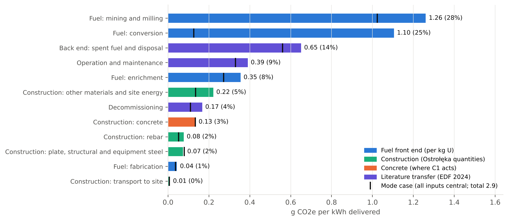
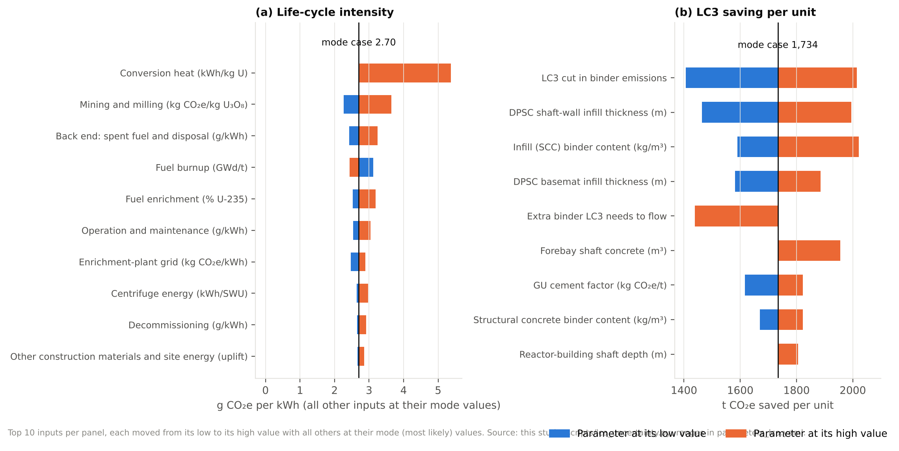
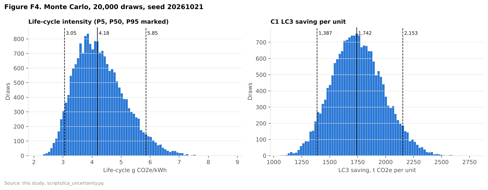
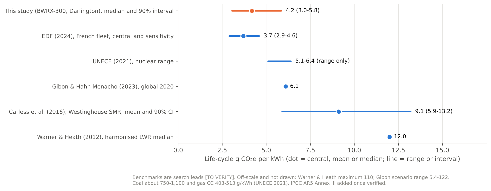

Rubric coverage: R2.1, R2.2, R2.3, R2.4, R2.5, R2.6, R2.7, RB.5, RB.6, R4.2, R4.4, R1.3, R5.2

> **Re-based 25/10/2026: the main case is now in `lca_rebase_deck.md`** (Ostrołęka PIS 50,000 m³ and 14,000 t per unit; Pillai 2019 OPC 380 vs LC³ 270 kg CO₂e/m³; C1 on 20/40/60% of the concrete). The 21/10 bottom-up model described below (20,700 m³) is kept as the cross-check; its numbers here are no longer the headline. The scripts and the CSV/MD results files now carry the main case.

# Life-cycle assessment of one BWRX-300 at Darlington, and the C1 LC3 initiative

lca-analyst, 21/10/2026 (revised 21/10 evening for plan §7 job Q1: like-for-like steel row, Monte Carlo shares for every scenario, conversion-heat distribution test, F3/F5 redrawn, S0 counterfactual, corrections L31/L60/L61/L64/L66 and L57), for §6, §4.3 (technical numbers), Appendices A, C and D, figures F1–F5 and table T6. Victor owns this work since he took over Sam's red sections (CLAUDE.md). Sam's `Assumptions.docx` and `Accounting.xlsx` are untouched; the corrected sheet is `03_LCA_Calculations/Accounting_corrected.csv`.

> **Verification status. No input has been confirmed in a primary source.** The proxy blocked every primary host from this session (list in `02_Research/sources_lca.md`). Every factor is a web-search lead (`TO VERIFY`), a stated assumption, or a placeholder for Leroy's plant data. Under CLAUDE.md rule 3, nothing here supports an HD mark until a person opens the priority sources and the fact-checker confirms them. The **method, arithmetic and reproducibility** are complete. If any value changes, edit `parameters_lca.yaml` and re-run the three scripts; every table and figure regenerates.

Reproduce (about 5 s in total):
```
python3 -I 03_LCA_Calculations/scripts/lca_baseline.py
python3 -I 03_LCA_Calculations/scripts/lca_scenarios.py
python3 -I 03_LCA_Calculations/scripts/lca_uncertainty.py
```
Generated tables: `lca_baseline.md`, `lca_scenarios.md` (incl. the S0 counterfactual), `lca_uncertainty.md` (incl. Monte Carlo scenario shares and the conversion-heat test), plus CSVs (`lca_scenarios.csv`, `lca_s0_counterfactual.csv`, `lca_montecarlo_summary.csv`, `lca_mc_conversion_alt.csv`, …). Figures: `F1_system_boundary.png` … `F5_benchmarks.png`. matplotlib 3.11 was installed into this environment for the charts.

---

## 0. Headline numbers (for slides 5 and 7, §4.3, §6 and §7)

| Quantity | Central | 90% interval (Monte Carlo P5–P95) | Note |
|---|---|---|---|
| **Life-cycle intensity, one BWRX-300** | **4.2 g CO₂e/kWh** (median) | **3.0–5.8** | Mean 4.3. The "mode case" (every input at its most likely value) is 2.7: several inputs are right-skewed, so the distribution sits above it (§8). **Depends on the conversion-heat distribution:** median 3.3 (2.6–4.2) with conversion heat held at Gibon's central 26 kWh/kg U; 3.9 (2.9–5.9) log-uniform 26–665 (§8.1). Range of medians 3.3–4.2 |
| Life-cycle total, one unit, 60 years | about 0.6 Mt CO₂e (4.2 g/kWh × 1.419 × 10⁸ MWh) | 0.43–0.83 Mt | Mode case 0.38 Mt |
| **Concrete per unit, whole plant** | **20,700 m³** (69 m³/MWe × 300 MWe) | **15,000–36,500 m³** (MC); bounds 10,350–41,400 | Scaled, not measured: ESBWR intensity (Peterson et al., 2005), GEH claim as low, ABWR as high |
| **of which C1 target structures** (DPSC infill + forebay shaft) | **13,100 m³** | 12,200–15,600 m³ | DPSC infill 9,081 m³ is a geometric estimate with assumed thicknesses |
| **LC3 saving per unit** (S2 vs S0) | **1,730 t CO₂e** | **1,390–2,150 t** | Concrete A1–A3 only |
| **LC3 saving, Units 2–4** | **5,200 t CO₂e** | **4,160–6,460 t** | Unit 1's basemat is placed and its forebay well advanced; whether Unit 1's shaft-wall infill could still use LC3 is [TO VERIFY] |
| LC3 saving as share of one unit's life cycle | **0.3%** (MC median 0.29%) | 0.18–0.46% | Mode case 0.45%. Slag (S1) MC median 0.28% (0.17–0.44%); S2b 0.46% (0.26–0.80%). All shares on one basis in §5 |
| LC3 saving as share of the target concrete | 34% | — | S2 vs S0 |
| Clinker avoided | 2,300 t per unit; **6,900 t for Units 2–4** | — | Clinker 0.92 → 0.50 t/t binder |
| Slag blend (S1) saving, for comparison | 1,550 t per unit (MC median 1,640) | 1,210–2,110 t | LC3 beats slag in only **64%** of draws |
| **Steel, like-for-like** (S3 low-end factors on the C1 target-structure steel only: 953 t DPSC basemat plate + 1,000 t forebay rebar) | **566 t per unit** (MC median 941) | 404–1,581 t | About one-third of LC3 in the same structures. Shaft-wall DPSC plate unknown and excluded, so a floor |
| Steel, whole-plant upper bound (all steel at best-practice EAF sections factors) | 3,710 t per unit (MC median 4,730) | 1,710–9,080 t | About 2× LC3, but a sections factor applied to forgings and nuclear plate is not shown to be feasible. World-average steel: 8,400 t **higher** |
| S0 counterfactual (if OPG's mixes already contain slag) [TO VERIFY] | LC3's increment 181 t per unit (slag 40%); 763 t (slag 25%) | MC LC3 − slag: −340 to +570 t | Life cycle barely moves (2.69 g/kWh mode case). See §5.2 |
| **Biggest hotspot** | **Uranium mining and milling**: 1.26 g/kWh expected (29%) | 0.75–1.89 | Conversion is second on the expected basis (1.09 g/kWh, 26%) because of a very wide energy range |
| Construction (all) | 0.32 g/kWh (7.5%) | 0.20–0.48 | Concrete alone 1.5%; steel 2.6% (expected basis) |

**Slide-ready wording.** Slide 5: "about 21,000 m³ of concrete per unit (13,000 m³ in the steel-composite modules and shafts we target), scaled from published reactor data". Slide 7: "Our BWRX-300 estimate: about 4 g CO₂e/kWh (90% range 3–6), just below UNECE's 5.1–6.4 (our interval overlaps it) and at the low end of the wider literature range. LC3 saves about 1,700 t CO₂e per unit, 5,200 t across Units 2–4: about 0.3% of each unit's life-cycle footprint. In the same structures, low-carbon steel would save about a third as much; across the whole plant, up to about 2× (upper bound)."

---

## 1. Goal and scope (ISO 14040/14044) [R2.5, R2.4]

- **Goal.** Quantify the life-cycle greenhouse-gas emissions of electricity from one BWRX-300 at the Darlington New Nuclear Project (Clarington, Ontario), find the hotspots, and size what initiative C1 (LC3 concrete in the DPSC modules and shafts of Units 2–4) would save. Audience: the unit's markers and, notionally, OPG. Comparative use: against coal, gas and published nuclear LCAs (§9). Not an ISO-compliant comparative assertion for public disclosure (no critical review).
- **Functional unit.** 1 MWh of net electricity delivered at the plant's grid connection. Transmission losses beyond the plant are excluded.
- **Reference flow.** One BWRX-300 unit over its design life: 300 MWe net × 8,760 h × 0.90 × 60 years = **1.419 × 10⁸ MWh** (placeholders, the same values as `parameters_run1.yaml`, so §6 and §7 share one denominator; 315 MWe also carried, see §11).
- **System boundary (F1).** Cradle to grave:
  - Construction materials: concrete, rebar, plate, structural and equipment steel; transport to site; other materials and site energy as an uplift.
  - Fuel front end: mining and milling, conversion, enrichment (centrifuge), fabrication. Built **bottom-up per kg of uranium** from a mass balance sized to the BWRX-300.
  - Operation and maintenance; decommissioning; back end (spent-fuel storage, conditioning, deep geological repository): **literature values per kWh**, transferred from EDF's 2024 French-fleet LCA.
  - So this is **a process-based LCA, with O&M, decommissioning and back end taken from secondary per-kWh data** (not a "hybrid" LCA, which in LCA usage means process plus input–output; factcheck L61). §6.1 must say so.
- **Cut-offs (stated, not hidden).** Fuel cladding and assembly hardware manufacture; conversion chemicals (HF, H₂, NH₃); capital goods of fuel-cycle plants; grid transmission; recycling credits (module D). Each one biases the result **low** (§10).
- **Baseline counterfactual (S0).** "What OPG would otherwise pour", modelled as general-use (GU) cement in all concrete. Whether NEDO-33926 or OPG's mixes already permit or use slag or fly ash is **not known** [TO VERIFY]. If they do, S0 becomes a slag blend and C1's increment shrinks to the LC3-minus-slag difference (§5.2).
- **Allocation.** None needed inside the foreground. Slag is a by-product of iron-making; its EPD factor (146.6 kg/t) carries the producer's allocation choice [TO VERIFY in the SCA EPD].
- **End of life.** Cut-off (recycled-content) approach: steel takes the burden of its scrap input, and no credit is given for future recycling of steel or crushed concrete. Granta's "EoL potential" is therefore reported separately, not netted (see `granta_inputs.md`).
- **Impact category and characterisation.** Climate change; GWP100. The CAC cement EPD reports IPCC 2013 (AR5) [lead]; the other factors' GWP sets are TO VERIFY. For mostly fossil-CO₂ processes the AR4/AR5/AR6 choice moves results far less than the ranges used.
- **Data quality.** Geography: Ontario (cement, conversion grid), Saskatchewan (mining), USA (enrichment, fabrication grids and steel EPDs), France (O&M and back-end transfer). Time: EPDs 2017–2022, LCAs 2016–2025. All TO VERIFY.

---

## 2. Inventory [R2.1, R2.3, RB.5]

### 2.1 How the quantities were built
No whole-plant bill of materials for the BWRX-300 was found (searched: OPG EIS review report NK054-REP-07730-00055-R001, TVA's Clinch River ER ML25118A209 and SEIS ML26035A285, NEDO-33914 civil design; only front matter or summaries were visible). So:
1. **Whole-plant concrete and steel** = intensity per MWe × 300 MWe. Central = ESBWR (69 m³/MWe, 33 t/MWe; Peterson, Zhao and Petroski, 2005, via WNA), because the BWRX-300 is a scaled ESBWR. Low = GEH's claim of 50% less concrete (and steel) per MW than the ESBWR. High = ABWR (138 m³, 46 t/MWe), for small-plant scale penalties. **Central assumes GEH's claimed halving is offset by SMR diseconomies of scale** (assumption). This is the same "scaled from a large reactor" approach Geneski et al. use, and the plan's fallback (plan §10).
2. **C1 target structures** built from the parts we do know:
   - DPSC basemat infill: π/4 × 37² × 3.0 m = **3,226 m³** (diameter from the 37 m module; thickness assumed 2–4 m). Geometry source: OPG's story "Laying the foundation for the G7's first small modular reactor" (30 April 2026; URL in `sources_lca.md`, `opg_basemat_story`), **identified by web search but not opened** (opg.com blocked); figures seen in search summaries and news reports [TO VERIFY].
   - DPSC shaft-wall infill: π × (37 − 1.5) × 1.5 × 35 m = **5,855 m³** (depth from OPG's 35 m lift; wall thickness assumed 1.0–2.0 m).
   - Forebay shaft: **4,000 m³** (OPG update; a floor, high 6,000).
   - Total **13,081 m³**, 63% of the scaled plant. In 3.5% of Monte Carlo draws the scaled plant fell below the target volume, and the plant was then set equal to the target.
3. **Rebar** = 0.15 t/m³ × plant concrete (forebay ratio 0.25 is the high value; DPSC modules use faceplates instead of most rebar). Only splits total steel between the rebar and plate factors.

### 2.2 Inventory per unit (S0, central)

| Item | Quantity | Factor | t CO₂e | Basis |
|---|---|---|---|---|
| DPSC infill (SCC, 450 kg binder/m³) | 9,081 m³ | 414.3 kg CO₂e/m³ | 3,762 | geometric |
| Forebay shaft (350 kg/m³) | 4,000 m³ | 328.9 kg CO₂e/m³ | 1,316 | OPG |
| Other plant concrete (350 kg/m³) | 7,619 m³ | 328.9 kg CO₂e/m³ | 2,506 | scaled − target |
| Rebar | 3,105 t | 0.97 t/t | 3,012 | 0.15 t/m³ |
| Plate, structural, equipment steel (incl. the 953 t DPSC basemat module) | 6,795 t | 1.73 t/t | 11,755 | 33 t/MWe − rebar |
| Transport to site | 15 km concrete, 500 km steel | 0.10 kg/t-km | 570 | assumption |
| Other materials and site energy | +50% of the above | — | 11,460 | assumption |
| **Construction total** | | | **34,381** | 0.24 g/kWh |

Concrete 7,584 t CO₂e vs steel 14,767 t: **steel emits about twice what concrete does**, matching Geneski et al.'s early finding [TO VERIFY].

**Resource use (R2.3).** Concrete 69 m³/MWe and 0.35 kg/MWh (20,700 m³ × 2.4 t / 1.419 × 10⁸ MWh); steel 33 t/MWe and 0.070 kg/MWh. Fuel: 2.69 g enriched U, 20.7 g natural U and 0.0146 SWU per MWh. Net efficiency 300/870 = 34.5%.

**Fuel demand, sized to Darlington (feeds §8.3, review.md §8.3 point 5).** At 3.8% enrichment, 0.25% tails and 45 GWd/t (placeholders):

| | One unit per year | Four units per year |
|---|---|---|
| Enriched uranium | 6.35 t U | 25.4 t U |
| Natural uranium | 48.9 t U | 196 t U |
| Separative work | 34.4 tSWU | 138 tSWU |

### 2.3 Corrections to Sam's data (review.md items 1–4), in `Accounting_corrected.csv`
1. **Site:** Darlington is in **Clarington, Ontario**, not Ottawa (fix belongs in Sam's `Assumptions.docx`; noted, not edited).
2. **TBM volume:** 4,127.29 m³ = 4,000 m³ concrete + 127.39 m³ rebar, **not** a bored volume. Row 4 of the corrected sheet is a `[TODO: tunnel length × bored cross-section]`; TBM energy sits in the construction uplift meanwhile.
3. **Sheet:** the concrete and steel rows move from "Nuclear Fuel LCA" to **"SMR Parts LCA (construction)"**.
4. **Scope:** 9.6 million kg concrete and 1,000 t rebar are **one milestone of one Unit 1 structure** and are labelled PARTIAL. Whole-unit rows (scaled) are added. The 953 t DPSC basemat steel is added as its own row.
- Also fixed: the "[From X patent]" header is replaced by a source column; rebar uses a recycled-content (EAF) factor, not virgin steel; construction electricity is not assumed renewable (the uplift covers site energy on the Ontario grid). Unresolved: what preprint 202505.1533 is (preprints.org blocked).

---

## 3. Emission factors (T6 / Appendix D extract) [R2.5]

| Factor | Central | Range | Unit | Source key | Status |
|---|---|---|---|---|---|
| GU cement | 854 | 796–898 | kg CO₂e/t | cac2020_epd (Central region) | TO VERIFY |
| Slag cement | 146.6 | 93.4–146.6 | kg CO₂e/t | sca_epd; Lafarge NewCem | TO VERIFY |
| LC3 binder cut vs GU | 37% | 30–43% | — | five leads, median | TO VERIFY |
| Non-binder concrete share | 30 | 15–60 | kg CO₂e/m³ | assumption | assumption |
| Binder, DPSC SCC / conventional | 450 / 350 | 400–550 / 300–420 | kg/m³ | EFNARC lead / assumption | TO VERIFY / assumption |
| Rebar (EAF) | 0.97 | 0.89–1.99 | t CO₂e/t | crsi2017_epd; BCCA; ICE v3 | TO VERIFY |
| Plate, sections, equipment | 1.73 | 1.22–2.50 | t CO₂e/t | bcca2022_limits; assumption (high) | TO VERIFY |
| Mining and milling | 42 | 24–81 | kg CO₂e/kg U₃O₈ | parker2016 (Saskatchewan) | TO VERIFY |
| Conversion electricity / heat | 11.8 / 26 | 10.3–16.9 / 26–665 | kWh/kg U | gibon2023 | TO VERIFY |
| Enrichment | 50 | 40–100 | kWh/SWU | gibon2023 | TO VERIFY |
| Fabrication | 36 | 36–50 | kWh/kg U | gibon2023 | TO VERIFY |
| Grid: conversion (Ontario) | 0.0738 | 0.035–0.343 | kg/kWh | taf2025 | TO VERIFY |
| Grid: enrichment / fabrication (USA) | 0.373 | 0.05–0.637 / 0.20–0.637 | kg/kWh | epa_power_profiler | TO VERIFY |
| Natural-gas heat | 0.202 | — | kg CO₂/kWh | ipcc2006_gl | TO VERIFY |
| O&M / decommissioning / back end | 0.33 / 0.11 / 0.56 | 0.17–0.67 / 0.06–0.33 / 0.28–1.11 | g/kWh | edf2024_lca shares × 3.7 | TO VERIFY |

Full list with notes: `parameters_lca.yaml` (59 entries).

---

## 4. Baseline results by stage (F2) [R2.1, R2.2]



| Stage | Mode case g/kWh | Expected (MC mean) g/kWh | Share of expected |
|---|---|---|---|
| Fuel: mining and milling | 1.02 | 1.26 | 29% |
| Fuel: conversion | 0.13 | 1.09 | 26% |
| Back end: spent fuel and disposal | 0.56 | 0.65 | 15% |
| Operation and maintenance | 0.33 | 0.39 | 9% |
| Fuel: enrichment | 0.27 | 0.35 | 8% |
| Decommissioning | 0.11 | 0.17 | 4% |
| Construction: other materials and site energy | 0.08 | 0.14 | 3% |
| Construction: plate, structural, equipment steel | 0.08 | 0.07 | 2% |
| Construction: concrete | 0.05 | 0.07 | 2% |
| Fuel: fabrication | 0.04 | 0.04 | 1% |
| Construction: rebar | 0.02 | 0.04 | 1% |
| Construction: transport | 0.004 | 0.006 | 0.1% |
| **Total** | **2.70** | **4.28** | 100% |

Grouped (expected basis): fuel front end 64%, back end and decommissioning 19%, O&M 9%, construction 7.5% (0.3212 / 4.279; factcheck L57). **Which column to use:** quote the expected (or median) value as the result and the mode case only as "the most likely value of every input". The difference is real information: the inputs we know least about (conversion heat, mining at lower ore grades) can only push the result up.

---

## 5. Initiative scenarios [R2.3, R2.1, R4.2, R4.4]

| Scenario | t CO₂e saved per unit, mode case (MC median; P5–P95) | Units 2–4 (mode) | Clinker avoided per unit / Units 2–4 | % of target concrete | % of unit life cycle: mode / MC median (P5–P95) |
|---|---|---|---|---|---|
| S1 slag, 40% of binder (C1 fallback) | 1,552 (1,642; 1,205–2,113) | 4,657 | 2,019 / 6,057 t | 31% | 0.41% / 0.28% (0.17–0.44%) |
| **S2 LC3-50 (C1 target binder)** | **1,734 (1,742; 1,387–2,153)** | **5,201** | **2,304 / 6,913 t** | **34%** | **0.45% / 0.29% (0.18–0.46%)** |
| S2b LC3 in targets + slag in all other concrete (lever L1) | 2,488 (2,746; 1,809–4,107) | 7,464 | 3,286 / 9,857 t | 49% | 0.65% / 0.46% (0.26–0.80%) |
| **S3 like-for-like: low-end steel factors on the C1 target-structure steel only** (953 t DPSC basemat plate + 1,000 t forebay rebar) | **566 (941; 404–1,581)** | **1,698** | — | — | **0.15% / 0.16% (0.06–0.30%)** |
| S3 upper bound: all steel at best-practice EAF sections factors | 3,714 (4,731; 1,713–9,084) | 11,142 | — | — | 0.97% / 0.79% (0.28–1.68%) |
| S3 high: all steel at world-average (BOF) factors (adds emissions) | −8,399 (−6,695; −10,805 to −3,178) | −25,198 | — | — | −2.19% / −1.11% (−2.11 to −0.49%) |

Sources: `lca_scenarios.csv` (mode case), `lca_montecarlo_summary.csv` and `lca_uncertainty.md` "Scenario savings and life-cycle shares" (MC: each draw's saving ÷ the same draw's S0 total; 20,000 draws, seed 20261021). The MC median of the like-for-like steel row (941) sits above its mode (566) because the central plate factor (1.73) is drawn from a right-skewed 1.22–1.73–2.50 triangle, while the low-carbon specification stays at 1.22.

### 5.1 Per structure
Per structure (one unit): DPSC infill saves **1,291 t** with LC3 (142 kg CO₂e/m³) and 1,156 t with slag; the forebay saves 442 t (LC3) and 396 t (slag). Working and per-tonne binder factors: `lca_scenarios.md`.

### 5.2 S0 counterfactual: what if OPG's mixes already contain slag? [R2.5, R2.6]
We found no statement of whether GEH's NEDO-33926 (Rev. 2, NRC ML24110A134) SCC infill specification or OPG's Darlington mixes permit or use supplementary cementitious materials: the document and opg.com were blocked, and web searches returned nothing on the mix [TO VERIFY]. If they do, S0 = slag blend in all plant concrete (S0slag) and C1's increment = S2b (LC3 in the targets, slag elsewhere) against S0slag (`lca_s0_counterfactual.csv`):

| Counterfactual S0 | S0 vs GU, t per unit | S0 life cycle (mode) | LC3 increment per unit | Units 2–4 | Clinker increment per unit | % of life cycle |
|---|---|---|---|---|---|---|
| Slag 25% of binder (S1 low) | −1,442 | 2.690 g/kWh | 763 t | 2,290 t | 1,042 t | 0.20% |
| Slag 40% of binder (S1 central) | −2,307 | 2.684 g/kWh | 181 t | 543 t | 285 t | 0.05% |

On a 40% slag baseline LC3's carbon increment is within noise (MC LC3 − slag: median 97 t, P5–P95 −343 to +574 t). The **carbon** case is then for low-clinker infill as such; the case for **LC3 specifically** rests on clinker (it still avoids 285–1,042 t per unit) and on slag supply.

### 5.3 What the scenarios say (the honest finding, R4.4)
1. **C1 passes the plan's own test (plan §2.1).** Concrete is about 66% of the target structures' known embodied CO₂e (5,078 t concrete vs 2,619 t for the forebay rebar and the DPSC basemat steel), above the 40% threshold, and the LC3 saving (1,730 t) exceeds the largest quantity-scaling swing on the saving (wall thickness, 530 t).
2. **But it is small at plant scale:** about 0.3% of a unit's life cycle, and 0.01–0.02 g/kWh.
3. **Slag nearly matches LC3.** The central difference is only 180 t per unit, and LC3 wins in only 64% of Monte Carlo draws. Slag already has nuclear precedent [TO VERIFY]. So LC3's case rests on **slag supply risk** (Ontario's shift to EAF steel, plan §2.1 point 2; unsourced, factcheck L18) and on the LC3 qualification work, not on a bigger saving. If OPG's baseline already contains slag, see §5.2.
4. **Within the structures C1 targets, concrete is the bigger lever; across the whole plant, steel is.** The same low-end steel factors applied only to the known steel in the target structures save **566 t per unit** (MC median 941 t, 404–1,581), about one-third of LC3's 1,734 t. (The shaft-wall DPSC plate tonnage is unknown and excluded, so this is a floor [TODO: NEDO-33926 / OPG].) Moving **all** 9,900 t of plant steel to those factors saves 3,714 t, about 2× LC3, but that is an **upper bound**: it applies a hot-rolled *sections* factor (1.22 t/t) to forgings and nuclear-grade plate, for which it is not shown to be feasible. Lower-carbon steel is therefore the next lever (§10), not part of C1.
5. **Schedule dominates.** Using `results/schedule_value.md` (Darlington U2–U4, 2035 start): 1.73 kt × 5.6–8.4 days per kt (Ontario average trajectory) = **10–15 days of delay** cancel one unit's LC3 saving; on the marginal-declining case (0.8 days per kt) only **about 1.4 days**. The "schedule-neutral" condition in the thesis is therefore decisive, not a footnote. (Arithmetic here; §7's analyst owns the inputs.)

---

## 6. Hotspots [R2.1, R2.2]

1. **Uranium mining and milling**, 1.26 g/kWh expected (29%; mode 1.02, 38%). Already low because Saskatchewan ores are high-grade (3.8% U₃O₈ production-weighted; Parker et al., 2016). Fuel from lower-grade or global-average supply would raise it (§9).
2. **Conversion**, 1.09 g/kWh expected (26%) but only 0.13 in the mode case. This is an **uncertainty hotspot**, not a measured one: Gibon (2023) gives conversion heat 26–665 kWh/kg U. Cameco's Port Hope plant data would collapse it (§12 request).
3. **Back end** (0.65, 15%), transferred from France (reprocessing); Canada plans direct disposal, so this may be an overestimate.
4. **Construction is 7.5%**, and **concrete 1.5%** (expected basis). C1's target concrete is 1.3% of the mode-case total.

---

## 7. Tornado (F3) [R2.7]



Ranked swing in life-cycle g/kWh (each input low → high, others at their mode values; full table in `lca_uncertainty.md`). F3 (redrawn 21/10) uses plain labels, marks the centre line "mode case 2.70" (left) and "mode case 1,734" (right) so it is not read against the 4.2 median, and carries no embedded "Figure F3" title (the Word caption does):

| Rank | Parameter | Low → high | g/kWh at low → high |
|---|---|---|---|
| 1 | Conversion heat | 26 → 665 kWh/kg U | 2.70 → 5.37 |
| 2 | Mining and milling factor | 24 → 81 kg/kg U₃O₈ | 2.26 → 3.65 |
| 3 | Back-end g/kWh | 0.28 → 1.11 | 2.42 → 3.25 |
| 4 | Burnup | 35 → 55 GWd/t | 3.12 → 2.44 |
| 5 | Enrichment | 3.4 → 4.95% | 2.53 → 3.19 |
| 6 | O&M g/kWh | 0.17 → 0.67 | 2.54 → 3.04 |
| 7 | Enrichment-plant grid | 0.05 → 0.637 kg/kWh | 2.47 → 2.89 |
| 8 | Centrifuge energy | 40 → 100 kWh/SWU | 2.65 → 2.97 |
| 9 | Decommissioning | 0.06 → 0.33 | 2.65 → 2.92 |
| 10 | Construction uplift | 0.25 → 1.5 | 2.66 → 2.86 |

**No concrete input** (concrete intensity, binder contents, cement factor) moves the total by more than 0.07 g/kWh (concrete intensity 0.065). **Steel and the uplift move it more:** construction uplift 0.20, steel intensity 0.17, plate factor 0.09 g/kWh (factcheck L64; `lca_tornado.csv`). For the **LC3 saving**, the top drivers are the LC3 GWP cut (1,406 → 2,015 t), DPSC wall thickness (1,464 → 1,995 t), SCC binder content (1,590 → 2,021 t), basemat thickness, and the extra binder LC3 may need for flow (0% → 10% cuts the saving to 1,438 t). So **the saving depends mainly on the DPSC geometry and the mix design**, which OPG/GEH data and mock-up trials would fix.

---

## 8. Monte Carlo (F4) [R2.7]



- 20,000 draws, seed 20261021, 40 parameters varied independently: triangular (low, central, high) except net MWe, which is uniform 300–315.
- **Life cycle: median 4.18, mean 4.28, P5 3.05, P95 5.85 g CO₂e/kWh.**
- **LC3 saving: median 1,742, P5 1,387, P95 2,153 t per unit; Units 2–4: 5,225 (4,161–6,458) t.**
- LC3 saving share of life cycle: median 0.29% (0.18–0.46%). Shares for S1, S2b and all S3 rows on the same basis: §5 table.
- Why the median (4.2) sits above the mode case (2.7): conversion heat (mode 26, high 665), the back end, decommissioning, the construction uplift and the grid factors all have long upper tails. Together with the other skewed inputs, they add about 1.6 g/kWh to the mean (4.28 vs 2.70).
### 8.1 Conversion-heat distribution test (Table C2 row) [R2.7]
The headline depends on how conversion heat is distributed (Gibon: 26, range 26–665 kWh/kg U). Re-run with the **same draws** for the other 39 inputs (`lca_mc_conversion_alt.csv`):

| Conversion heat | Mean heat kWh/kg U | Life cycle median g/kWh (P5–P95) | Mean | LC3 share median (P5–P95) |
|---|---|---|---|---|
| Triangular 26/26/665 (baseline) | 239 | **4.18** (3.05–5.85) | 4.28 | 0.29% (0.18–0.46%) |
| Held at the sourced central 26 | 26 | **3.31** (2.62–4.18) | 3.34 | 0.37% (0.25–0.54%) |
| Log-uniform 26–665 | 197 | **3.91** (2.89–5.91) | 4.10 | 0.31% (0.19–0.49%) |

So the median is **not** robust to this one choice: it ranges 3.3–4.2 g/kWh. Reporting suggestion for §6.4: keep 4.2 (3.0–5.8) as the headline on the stated distribution, and add "3.3 if conversion heat is at its sourced central value; the range of medians across three conversion-heat assumptions is 3.3–4.2". Every case stays below UNECE's 5.1–6.4, and C1's share stays 0.3–0.4%. A measured Port Hope value (§13) would settle it.

- Limitations: independence is assumed (concrete and steel intensities are probably correlated; this would widen the construction tail slightly); ranges are partly analyst judgement (labelled in the YAML); the triangular shape is a convention, not data.

---

## 9. Benchmarks (F5) [RB.6, R2.7, R1.3]



F5 (redrawn 21/10): UNECE is drawn as a **range only** (5.1–6.4; no midpoint, factcheck L66); Warner and Heath as a median only (12; the maximum 110 is off-scale, and **no 3.7 minimum is attributed to them**, factcheck L31); no embedded title. The IPCC AR5 WGIII Annex III row (min 3.7, median 12, max 110 as commonly quoted) is held in `parameters_lca.yaml` (`bm_ipcc2014_*`, TO VERIFY) and is drawn automatically once all three are set to `verified`.

| Benchmark | g CO₂e/kWh | Our result relative to it |
|---|---|---|
| EDF (2024), French fleet | 3.7 (2.9–4.6) | Overlaps |
| UNECE (2021), nuclear | 5.1–6.4 (range) | Median just below; interval overlaps (with conversion heat at 26: 3.3, below; P95 4.2) |
| Gibon & Hahn Menacho (2023), global 2020 | 6.1 | Below |
| Ng et al. (2025), US fuel cycle only | 3.0 | Our expected front end 2.7 (mode 1.5); consistent |
| Carless et al. (2016), Westinghouse SMR | 9.1 (5.9–13.2) | Below; intervals touch |
| Warner & Heath (2012), harmonised LWR median | 12 (max 110; no minimum in the lead) | Well below |
| IPCC AR5 WGIII Annex III, nuclear [TO VERIFY; not yet plotted] | median 12 (min 3.7, max 110) | Inside the range, well below the median |
| Coal / gas CC (UNECE, as on slide 7) | about 750–1,100 / 403–513 | 100–250× lower |

**Why ours is at the low end (each reason has a sign and a size):**
1. **High-grade Canadian ore (lowers ours).** Our mining is 1.0–1.3 g/kWh (Parker et al., 2016, about "a gram per kWh"). Gibon attributes 46% of 6.1 g, about 2.8 g/kWh, to mining and milling at global-average grades. That one stage explains most of the gap to UNECE and Gibon.
2. **Centrifuge only (lowers ours vs older studies).** Warner & Heath's harmonised set includes diffusion-era studies (2,500 kWh/SWU vs 50); Gibon's centrifuge-only median is about half its diffusion median.
3. **Energy-only fuel inventory (biases ours low).** Conversion chemicals, cladding and fuel-plant capital goods are cut off.
4. **Construction may be low.** Ours is 0.24–0.31 g/kWh. EDF's construction share is 16% of 3.7 = 0.59 g/kWh for large PWRs, and an SMR should need more material per MWh, not less. If construction were 0.6–1.0 g/kWh, the total would rise about 0.3–0.7 g/kWh and LC3's share would fall further. The uplift and the intensity are the inputs to check.
5. **Denominator (lowers ours).** 60 years at 0.90 capacity factor. At 40 years the mode case rises to 2.82 (tornado).
6. **Literature transfer.** O&M and back end come from a French fleet that reprocesses; Canada plans direct disposal.
7. **SMR vs large reactor.** Carless et al. find the SMR about 9% above the AP1000 mainly through the fuel cycle; without it they are effectively equal. Our construction share (7.5%) is small enough that scale effects can't move the headline much.

**Conclusion for §6.5:** the result sits inside the published nuclear range and at its low end, for identifiable reasons (Canadian ore, centrifuge enrichment, a long life), with a known low bias from cut-offs.

---

## 10. Key caveats (for §6.4 and §11) [R2.6, R2.7]

1. All inputs are unverified leads, assumptions or placeholders. The largest are conversion heat, the mining factor, burnup, enrichment and the EDF transfers.
2. The concrete volume is **scaled, not measured**. The C1 target volume rests on two assumed thicknesses.
3. The DPSC infill binder content (450 kg/m³) and LC3's extra binder demand are assumptions until a mix is designed. Both move the saving by ±15–25%.
4. LC3's cut (30–43%) comes from Indian and Cuban LCAs on other grids; an Ontario LC3 (calcining with natural gas) is untested.
5. Nuclear qualification is not modelled: if LC3 delays Units 2–4 by more than about 1.4–15 days, the climate benefit reverses (§5.3 point 5).
6. Mixed data: a process-based LCA in which O&M, decommissioning and the back end are secondary per-kWh transfers, not an inventory.
7. The headline median depends on the conversion-heat distribution: 4.2 (triangular), 3.9 (log-uniform), 3.3 (held at 26) g/kWh (§8.1).
8. The S0 counterfactual is unknown: if OPG's mixes already contain 25–40% slag, LC3's increment falls from 1,734 t to 181–763 t per unit (§5.2).
9. The steel comparison is like-for-like only on the known target-structure steel (953 t + 1,000 t); the shaft-wall DPSC plate is not counted.

---

## 11. Consistency with the slide deck (contradictions to fix before Thursday 15:00)

| Slide | Says | Problem | Fix |
|---|---|---|---|
| 6 (lca-method) | "Tools: Granta EduPack Eco Audit, cross-checked in Excel" | **No Granta run exists.** The numbers come from the Python model | "Python LCA model (Appendix C); Granta Eco Audit check of the construction materials" (only if the run is done; otherwise drop Granta) |
| 6 | "Partial quantities (Darlington forebay shaft, OPG) scaled to the whole plant" | Quantities are scaled from **per-MWe intensities** (ESBWR/ABWR, GEH claim), with the forebay as one known structure | "Plant quantities scaled from published reactor data; forebay and basemat from OPG" |
| 7 (lca-results) | Source line "our estimate: Granta EduPack Eco Audit (Appendix)" | Not Granta | "our estimate: process-based LCA, Appendices A and C" |
| 7 | "[Sam: __ g] · LC3 saves [__] t CO₂e per unit" | Placeholders (factcheck S18) | "about 4 g (3–6) · LC3 saves about 1,700 t CO₂e per unit" |
| 7 notes | "[is / isn't] inside the UNECE range because [reason]" | — | "just below UNECE's 5.1–6.4 (our interval overlaps it), mainly because Darlington's uranium is assumed to come from high-grade Saskatchewan mines" (factcheck L56; mining source TO VERIFY with OPG/Cameco) |
| 7 | "slag almost as much; steel about 2×" | Not like-for-like (review.md §6 point 4) | "slag nearly matches; in the same structures low-carbon steel saves about a third as much; whole-plant low-carbon steel up to about 2× (upper bound)" |
| 7 notes | "about [__]% of the plant's life-cycle footprint"; plan's "1% or less" | Consistent | "about 0.3%" |
| 5 (proposal) | "about [__] m³ of concrete per unit" (S13) | Placeholder | "about 21,000 m³ per unit (13,000 m³ targeted)" |
| 5 | "3 × 300 MWe" | 300 vs 315 MW net unresolved (factcheck S3) | Keep 300 until Leroy confirms; the LCA carries both (315 lowers the result by about 2.6%) |
| 8 (§7 displacement) | uses UNECE midpoint 5.75 g/kWh for the SMR | Our 4.2 (3.0–5.8) replaces it; the displacement results change by under 5% (benchmark brief §4) | Analyst updates `parameters_run1.yaml` |

Thesis check (plan §2.4): "would save [X] t CO₂e per unit, about [Y]%" → X ≈ 1,700 t, Y ≈ 0.3%. The thesis holds and gains two points: slag nearly matches LC3, and within the structures C1 targets LC3 beats low-carbon steel about 3:1, while across the whole plant steel is the larger lever (up to about 2× LC3, an upper bound).

---

## 12. Appendix-ready full working (Appendices A, C, D) [RB.5, R2.4]

**Lifetime output.** E = P_net × 8,760 × CF × L = 300 × 8,760 × 0.90 × 60 = 1.419 × 10⁸ MWh.

**Concrete.** For each structure, kg CO₂e = V × (b × EF_binder / 1000 + c), where V is the volume (m³), b the binder content (kg/m³), EF_binder (kg CO₂e/t binder) and c the non-binder share (kg/m³).
- EF_binder: S0 = EF_GU; S1 = (1 − s) EF_GU + s EF_slag; S2 = EF_GU (1 − r) with b × (1 + u).
- Clinker (t) = V × b × CF / 10⁶, with CF 0.92 (GU), (1 − s) × 0.92 (S1), 0.50 (LC3).
- Example, DPSC S0: 9,081 × (450 × 854 / 1000 + 30) / 1000 = 9,081 × 0.4143 = 3,762 t.
- Example, DPSC S2: 9,081 × (450 × 538.0 / 1000 + 30) / 1000 = 2,471 t; saving 1,291 t.

**Geometry.** V_basemat = π/4 D² t_b; V_wall = π (D − t_w) t_w h.

**Steel.** Total = I_s × P_net; rebar = min(ρ × V_plant, total); other = total − rebar; kg CO₂e = rebar × EF_r + other × EF_o (t × t/t).

**Construction total.** (concrete + steel + transport) × (1 + uplift). Savings exclude the uplift.

**Steel, like-for-like (S3lfl).** Saving = m_plate,DPSC × (EF_o − EF_o,low) + m_rebar,forebay × (EF_r − EF_r,low) = 953 × (1.73 − 1.22) + 1,000 × (0.97 − 0.89) = 486 + 80 = 566 t per unit; Units 2–4 = 1,698 t. Whole-plant S3 upper bound = rebar_t × (EF_r − EF_r,low) + other_t × (EF_o − EF_o,low) = 3,105 × 0.08 + 6,795 × 0.51 = 3,714 t.

**S0 counterfactual.** S0slag = slag share s in all concrete; LC3 increment = S0slag − S2b = target volume × binder × (EF_slag-blend − EF_LC3) (with LC3 binder uplift). At s = 0.40: binder factors 571 vs 538 kg/t, so 9,081 × 0.450 × 33.0 + 4,000 × 0.350 × 33.0 = 135 + 46 ≈ 181 t (binder in t/m³, factor gap in kg CO₂e/t binder, result in kg → t).

**Fuel (per MWh).**
- kWh_e per kg enriched U = B × 24,000 × η, with η = 300/870 = 0.345. At B = 45: 372,414 kWh/kg, so 2.685 g enriched U per MWh.
- Feed F = (x_p − x_t)/(x_f − x_t) = (3.8 − 0.25)/(0.711 − 0.25) = 7.70.
- SWU/kg = V(x_p) + (F − 1) V(x_t) − F V(x_f), with V(x) = (2x − 1) ln[x/(1 − x)]: 2.986 + 6.70 × 5.959 − 7.70 × 4.869 = 5.42.
- Mining = natU × 42 / 0.848 = 0.02068 × 49.5 = 1.02 kg/MWh (= g/kWh).
- Conversion = natU × (11.8 × 0.0738 + 26 × 0.202) = 0.02068 × 6.12 = 0.127.
- Enrichment = 0.002685 × 5.42 × 50 × 0.373 = 0.272.
- Fabrication = 0.002685 × 36 × 0.373 = 0.036.

**Monte Carlo.** N = 20,000, seed 20261021, `numpy.random.default_rng`; triangular(low, central, high) or uniform(low, high) per the YAML `dist`; outputs: percentiles 5/50/95 and the mean; stage means are additive. Scenario shares: saving_i / S0 total_i per draw. Conversion-heat test: the same draws for the other inputs; conversion heat fixed at 26, or exp(U(ln 26, ln 665)) from a separate stream (seed + 1).

**Tornado.** For each of the 40 ranged parameters, the output at low and at high with all others at central; sorted by swing.

---

## 13. Gaps and requests (also appended to plan.md §5)

| Gap | Effect | Who | Fix |
|---|---|---|---|
| No primary opened | Nothing can be HD-verified | Victor (human) | Open, in order: Gibon 2023 (PMC copy: conversion ranges), Parker 2016, EDF 2024 (shares), CAC 2020 EPD (Ontario region), St Marys Bowmanville EPD, CRSI 2022 EPD, Peterson 2005 tables, the LC3 leads, Carless 2016, UNECE 2021 |
| Conversion energy | Largest single uncertainty (±2.7 g/kWh) | Victor | Canada's GHG Reporting Program facility data for Cameco's Port Hope Conversion Facility (t CO₂e/yr) ÷ annual UF₆ output (Cameco annual report) gives a measured kg CO₂e/kg U |
| Plant data | Denominator and fuel | Leroy | Net MWe (300 or 315), CF, design life (60 or 65), discharge burnup, reload enrichment, cycle length, reload fraction, fabrication site, enrichment supplier |
| Quantities | Concrete volume, C1 target | Leroy / Victor | OPG EIS review report NK054-REP-07730-00055-R001; TVA ER ML25118A209; NEDO-33914/NEDO-33926 for DPSC wall and basemat thickness and shaft-wall plate tonnage; is the forebay per unit or shared? |
| Basemat geometry source (L9) | 69% of the target concrete | Victor (human) | Open OPG (2026) https://www.opg.com/news-and-media/story/laying-the-foundation-for-the-g7s-first-small-modular-reactor and confirm 37 m, 35 m, 2.1 million lb; then set `opg_basemat_story` to verified and cite OPG, not the news report |
| S0 counterfactual | LC3's increment 181–1,734 t | Victor / Leroy | NEDO-33926 concrete section or OPG mix submittals: are slag/fly ash permitted or used? |
| Fuel source | Mining hotspot | Leroy / Victor | Is Darlington's uranium Canadian (Cameco)? Which enricher (Urenco USA, Orano)? |
| Granta run | R2.2 eco-audit check | Team member with EduPack | `granta_inputs.md` (under 1 hour), by Thu 12:00 |
| Steel lever (C2) | Bigger than C1 | Leroy (§10) | One paragraph on EAF/DRI-EAF plate; S3 numbers here |
| Correlations | MC tails | — | Accept as a stated limitation |
